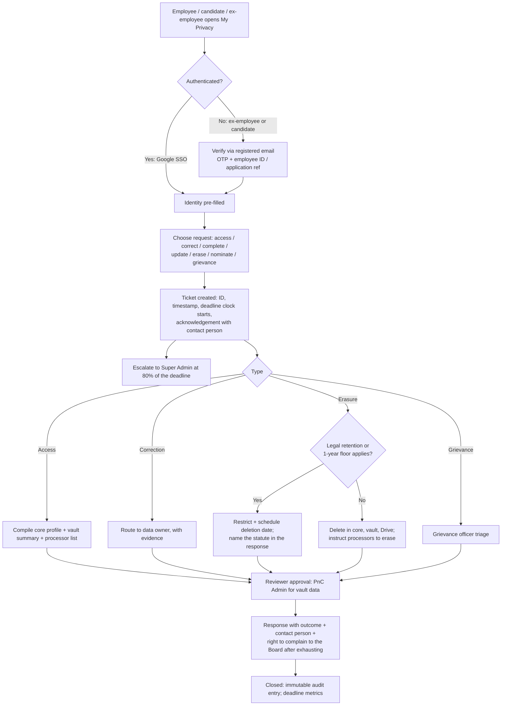
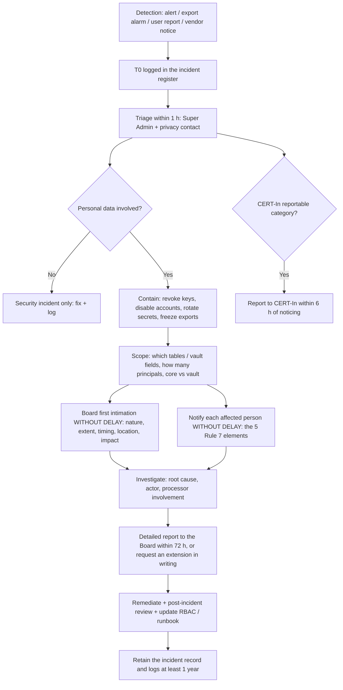

# DPDP compliance blueprint: what the law requires, and what the platform builds

The legal research behind the platform's privacy work: India's **Digital
Personal Data Protection Act 2023** (the Act) and the **DPDP Rules 2025** (the
Rules), read against the employee life cycle that PnC ELC runs.

[`README.md`](README.md) says where each requirement is implemented and which
check (`DPDP-xx`) proves it. The checker, run with `npm run dpdp:check` or from
**Settings → DPDP & Privacy → Compliance checker**, tracks progress. This page
holds no list of open items.

> **Status of this document.** This is research compiled on 6 November 2026,
> not legal advice. Every period, threshold and interpretation here is marked
> *counsel to confirm* in the settings screen until NavGurukul's legal counsel
> signs it off. Source labels in brackets (for example `[dpdpa]`, `[meity]`)
> name the publication each statement was taken from.

## Bottom line

- NavGurukul is **not yet legally bound** by most DPDP duties. The core
  obligations (notice, security safeguards, breach reporting, Data Principal
  rights, retention and erasure, children's data) start on **13 May 2027**
  `[legal500] [dpdpa]`. The platform's privacy features should therefore ship
  **before go-live on real data**, not after.
- There is **no exemption for non-profits.**
- The "employment purposes" ground in **Section 7(i)** removes most consent
  requirements for employee data. It does **not** remove notice-style
  transparency, security, retention or rights duties.
- Until May 2027, the **IT Act s.43A and the SPDI Rules 2011** still apply to
  bank details, health data and biometrics `[legal500]`.
- **CERT-In's 6-hour incident reporting** (Directions of 28 April 2022) applies
  **today**.

## TL;DR

- **Timeline.** Since 13 November 2025 only the definitions and Data Protection
  Board provisions have been in force. Consent Manager registration (Rule 4)
  starts around 13 November 2026, and is irrelevant unless NavGurukul chooses
  to use a Consent Manager. Everything that matters for an HR platform applies
  from **13 May 2027**.
  - On 22 January 2026 Business Standard reported, citing sources, that MeitY
    was "likely to shorten the implementation timeline" to 12 months for
    Significant Data Fiduciaries. That proposal was **never notified**.
  - The only change made after notification is a two-word Removal of
    Difficulties Order (S.O. 5458(E), 6 October 2026).
  - No startup or non-profit exemption has been notified `[dpdpactindia]`.
- **Employee data.** Section 7(i) lets NavGurukul process **current
  employees'** data for employment purposes without consent. Candidates,
  contractors, consultants, volunteers and alumni are on weaker ground and
  should get a notice and a consent (or a documented Section 7(a) basis).
  Aadhaar must be masked or vaulted. Children's data (dependants, any under-18
  intern) needs verifiable parental consent.
- **What to build, in priority order:**
  - **P0:** a data inventory; RBAC on the core/vault split; an immutable access
    log kept for at least 1 year; a breach runbook; a vendor register with
    signed DPAs (data processing agreements).
  - **P1:** notice templates and a notice/consent ledger; a self-service rights
    and grievance workflow (a published period of 90 days or less); a retention
    scheduler that reconciles DPDP erasure with labour, tax and FCRA retention
    (5 to 8 years for most payroll records).
  - **P2:** a consent dashboard, and nomination.

---

## 1. Legal status and timeline (as of 6 November 2026)

### 1.1 What is in force now

| Instrument | Date | Status | What it means for PnC ELC |
|---|---|---|---|
| DPDP Act 2023 (Act 22 of 2023) | Enacted 11 Aug 2023 | Phased commencement via G.S.R. 843(E) `[dpdprules]` | Core duties not yet enforceable |
| G.S.R. 843(E): Act commencement | 13 Nov 2025 | In force: ss. 1(2), 2, 18–26, 35, 38–43, 44(1) and (3) `[azbpartners] [dpdprules]` | Definitions plus Board machinery only |
| G.S.R. 844(E) / 845(E) | 13 Nov 2025 | Data Protection Board established; Chairperson + 4 Members `[dpdprules]` | The Board exists in law |
| DPDP Rules 2025, G.S.R. 846(E) | 13 Nov 2025 | Rules 1, 2, 17–21 in force `[dpdpa]` | Board procedure only |
| Corrigenda G.S.R. 892(E) | 10–11 Dec 2025 | In force | Eight textual fixes; quote the corrected text `[dpdprules]` |
| Removal of Difficulties Order, S.O. 5458(E) | Made 5 Oct, in force 6 Oct 2026 | In force | s. 9(1) now reads "child or **of** a person with disability"; s. 10(2)(c)(ii) "audit" becomes "data audit". No new duty and no date change `[dpdprules]` |
| IT Act s. 43A + SPDI Rules 2011 | Since 2011 | **Still in force until s. 44(2) commences (13 May 2027)** `[legal500]` | Binding today: a privacy policy, reasonable security practices, and written consent for "sensitive" data (passwords, financial information, health, biometrics) |

### 1.2 Phased commencement

| Phase | Rule 1 trigger | Computed date | Provisions | Relevance to NavGurukul |
|---|---|---|---|---|
| Immediate | Rule 1(2) | 13 Nov 2025 | Rules 1, 2, 17–21; Act ss. 1(2), 2, 18–26, 35, 38–43, 44(1),(3) `[dpdprules] [dpdpa]` | None operational |
| 12 months | Rule 1(3) | ~13 Nov 2026 | Rule 4 + First Schedule (Consent Manager registration); Act s. 6(9), 27(1)(d) `[dpdprules] [dpdpa]` | Optional; NavGurukul need not use a Consent Manager |
| 18 months | Rule 1(4) | **13 May 2027** | Rules 3, 5–16, 22, 23; Act ss. 3–5, 6(1)–(8),(10), 7–17, 27 (rest), 28–34, 36, 37, 44(2) `[dpdprules] [dpdpa]` | **All HR-relevant duties and penalties** |

**Date caveat.** The computed dates are interpretation `[dpdprules]`. The
Gazette is dated 13 November 2025, and PIB reported notification on
14 November `[pib] [dpdpa]`. A PIB release of 16 May 2026 quotes the MeitY
Secretary as saying the Act becomes "fully enforceable from 13 May 2027"
`[dpdprules]`. Plan against 13 May 2027.

### 1.3 Developments and clarifications since notification

| Development | Date | Status | Effect |
|---|---|---|---|
| Proposal to cut the 18-month window to 12 (at least for Significant Data Fiduciaries) and fast-track the cross-border and Rule 8(3) retention provisions `[ssrana] [dpdprules]` | 22–23 Jan 2026. Business Standard cited sources, and noted that the IT Minister had said in November 2025 that the government was "in talks with industry stakeholders to compress the compliance timeline… from 18 months to 12 months". KNN India (24 Jan 2026) reported the one-year retention of data and logs "could be enforced within 90 days of the Gazette notification" | **Reported only; never notified.** MeitY's document library held no amending instrument as of Oct 2026 `[dpdprules]` | No change. Watch for a Gazette amendment |
| MeitY summary of consultation submissions | 14 Jan 2026 | Published record, no legal effect | 6,951 comments processed `[dpdprules]` |
| Supreme Court challenge (Venkatesh Nayak v. UoI, W.P.(C) 177/2026), centred on the RTI amendment in s. 44(3) `[dpdprules]` | Notice 16 Feb 2026 | Pending; **stay refused** `[dpdprules]` | The framework operates as notified |
| Board recruitment: MeitY circular F. No. 2(1)/2026-Pers.I (6 May 2026); Employment News advertisement (6 Jun 2026); Lok Sabha USQ 3960 answer (12 Aug 2026) | May–Aug 2026 | **No Chairperson or Member appointed** as of late Oct 2026 `[indiadatalaw] [dpdprules]` | The Board cannot hold proceedings (no quorum) `[dapro]` |
| Kerala High Court, C R Neelakandan v. UoI (7 Oct 2026) | 7 Oct 2026 | Records the Union's submission that the Board "has yet to be made functional"; expects it functional within 8 weeks (~2 Dec 2026). An expectation, not a direction `[dpdprules]` | Enforcement capacity may arrive before May 2027 |
| Removal of Difficulties Order, S.O. 5458(E) | 6 Oct 2026 | In force | Editorial fixes only `[dpdprules] [dpdpactindia] [dpdpguard]` |

> **Source warning.** At least one vendor blog claims a Board Chairperson was
> appointed on 6 June 2026 `[dpdpguard]`. That conflicts with the Lok Sabha
> answer of 12 August 2026, which named no appointee, and with the Kerala HC
> record of October 2026 `[indiadatalaw] [dpdprules]`. Treat the claim as
> **unreliable**: 6 June 2026 was the date of the recruitment advertisement.

> **No official MeitY FAQs** on the DPDP Rules have been published. "FAQ" pages
> online are law-firm or vendor material, and some are wrong: one widely
> indexed FAQ claims a 7-day access-request deadline that does not exist in the
> Rules `[dpdpa]`.

### 1.4 Exemptions and relaxations

| Possible relief | Legal basis | Status | Applies to NavGurukul? |
|---|---|---|---|
| Non-profit or NGO exemption | None in the Act | — | **No** |
| Startups / notified classes exempt from s. 5 (notice), 8(3) (accuracy), 8(7) (erasure), 10 and 11 (access) `[meity]` | s. 17(3) | Power only; **no notification issued** (checked Oct 2026) | No `[dpdprules] [skillarbitra]` |
| Any provision disapplied for a class for a period `[meity]` | s. 17(5) (within 5 years of commencement) | Unexercised | No `[indiankanoon] [dpdpact]` |
| Research, archiving, statistics | s. 17(2)(b) + Rule 16 + Second Schedule `[meity] [dpdpa]` | Operates from May 2027 | Only for genuinely de-identified analytics with no individual decisions; not HR operations |
| Educational institution: tracking and behavioural monitoring of children `[dpdpa]` | Rule 12 + Fourth Schedule Part A item 3 | From May 2027 | Possibly for NavGurukul's *student* programmes. **Not** for HR data |
| Enforcing legal claims `[meity]` | s. 17(1)(a) | From May 2027 | Covers retaining records for disputes and litigation holds |

---

## 2. Employment-specific provisions

### 2.1 Section 7(i), verbatim

> "(i) for the purposes of employment or those related to safeguarding the
> employer from loss or liability, such as prevention of corporate espionage,
> maintenance of confidentiality of trade secrets, intellectual property,
> classified information or provision of any service or benefit sought by a
> Data Principal who is an employee." `[meity]`

**How far it extends:**

- **What it covers.** Consent is not needed for genuine employment processing:
  payroll, statutory filings, attendance, performance, leave, confirmations,
  appraisals, letters, benefits the employee asks for, and security and
  confidentiality controls.
- **What it does not cover.** It does not switch off the other duties. These
  all still apply:
  - security (s. 8(5))
  - breach notice (s. 8(6))
  - accuracy (s. 8(3))
  - erasure (s. 8(7))
  - the grievance mechanism and contact person (s. 8(9)–(10), s. 13)
  - correction and erasure rights (s. 12)

  Access (s. 11) strictly applies to consent-based processing, but best
  practice is to honour it.
- **Notice.** The formal Rule 3 notice is tied to consent. For Section 7(i)
  processing there is no prescribed notice. Even so, Rule 9 (publish contact
  information) and Rule 14 (publish how to exercise rights) apply.
  Practitioners argue that purpose limitation and minimisation should be read
  into s. 7(i) `[privacylawhub] [vaishlaw]`.
- **Where it stops** (use consent or another basis):
  - marketing or fundraising use of staff photos or stories
  - an alumni network
  - sharing data with donors or partners beyond reporting needs
  - optional wellness programmes
  - analytics unrelated to employment
  - anything done after the purpose has ended

### 2.2 Data Principal type matrix

| Data Principal | Recommended lawful basis | Consent needed? | Notes for PnC ELC |
|---|---|---|---|
| **Job candidate / applicant** (Candidate role) | s. 7(a) (data voluntarily provided for a specified purpose) **or** s. 6 consent | **Yes, recommended** for background verification, talent-pool retention and reference checks | Commentators flag that s. 7(i) is **silent on pre-employment** `[chambers]`. Take the safe route: a notice at application plus explicit consent for background verification and for keeping rejected profiles |
| **Pre-joiner** (offer accepted) | s. 7(i) (purposes of employment) | Not for core onboarding | Collect bank, ID and CTC only after acceptance, through the vault path |
| **Current employee** (full-time, associate, apprentice) | s. 7(i) | No, for employment purposes | Consent for non-employment uses (photos in fundraising decks, alumni list) |
| **Intern** (≥18) | s. 7(i) if engaged under an employment-type arrangement; otherwise s. 6 consent | Get consent if the internship is a training or education engagement rather than employment | Classify in `employee_type`; counsel to confirm |
| **Intern / student under 18** | s. 9 + Rule 10 | **Verifiable parental consent before any processing** | No tracking or behavioural monitoring. Penalty up to ₹200 crore |
| **Contractor / consultant** | Contract + s. 7(a) or s. 6 consent | **Yes, recommended** | Practitioners read "employee" narrowly; do not rely on s. 7(i) alone `[chambers]` |
| **Volunteer** | s. 6 consent (or s. 7(a)) | **Yes** | Minimal data only |
| **Ex-employee** | s. 7(i) for residual employment purposes (F&F, gratuity, PF transfer, experience letter) + s. 8(7) retention "necessary for compliance with any law" + s. 17(1)(a) legal claims | No, for statutory retention | Consent for alumni engagement or rehire pools. The Act is silent on post-exit "employment purposes" `[barandbench]` |
| **Dependants / nominees / emergency contacts** | Supplied by the employee; s. 7(i) benefit "sought by" the employee; s. 7(f) for medical emergencies | Children need verifiable parental consent (s. 9) | The employee is usually the parent. Capture an attestation from the already-verified employee (Rule 10(1)(a), "reliable details… available with the Data Fiduciary") `[dpdpa]` |

### 2.3 Sensitive categories common in HR

The DPDP Act has **no "sensitive personal data" tier** `[ksandk]`. The SPDI
Rules 2011 do, and they apply until May 2027. Treat these categories as
high-risk regardless.

| Category | Lawful basis | Extra rules | Required platform control |
|---|---|---|---|
| **Aadhaar** | s. 7(i) for identity / EPF UAN seeding | Aadhaar Act s. 29(4): never display publicly. UIDAI circulars: store **full numbers only in an Aadhaar Data Vault** behind reference keys; **mask** (first 8 digits hidden) all copies before storage | Mask at upload; store the last 4 digits in core; never in logs. Full number only where EPFO requires it. Any copy kept in a shared Drive folder is a **masked** copy `[skilldb]` |
| **PAN** | s. 7(i) (TDS, Form 16) | Income-tax law | Vault; mask in the UI (XXXXX1234X) |
| **Bank details** | s. 7(i) (salary) | SPDI "financial information" until May 2027 | Vault; Fin Admin approval; field-level encryption |
| **Health / medical** (sick leave, maternity, insurance, disability) | s. 7(i) (leave, benefits sought); s. 7(f) emergencies | SPDI until May 2027; maternity register under the Social Security Code | Store the leave *type and dates* in core and medical certificates in the vault. Delete certificates after the decision plus the 1-year floor, unless a statute requires longer |
| **Background verification** | Consent (pre-employment) | The BGV vendor is a Data Processor; a DPA is required | A consent record per check; keep only the *outcome* after joining; purge raw reports |
| **Biometric / attendance** | s. 7(i) | SPDI "biometric information" until May 2027 | Prefer non-biometric attendance. If biometric is used, store templates only with the vendor under a DPA, never in ELC |
| **Performance reviews / peer feedback** | s. 7(i) | Accuracy duty s. 8(3) (used for decisions) | Vault; an employee correction route; immutable versions |
| **Emergency contacts, family, dependants** | s. 7(i) / 7(f) | Third parties; children → s. 9 | Minimal fields; the employee attests that they informed the contact; parental attestation for minors |
| **POSH complaints** | Legal obligation (POSH Act) | No statutory retention period `[legal500]` | Separate restricted store; ICC access only; counsel to set retention |

---

## 3. Core obligations mapped to the employee life cycle

### 3.1 DPDP obligations by life-cycle stage

Legend: ● mandatory, applies strongly · ◐ applies partially or conditionally ·
○ recommended best practice · — not applicable.

| Obligation (source) | Recruitment (candidate) | Onboarding (pre-joiner) | Active: payroll, leave, performance, confirmation, appraisal | Exit / offboarding | Post-exit retention |
|---|---|---|---|---|---|
| Lawful basis (s. 4, 6, 7) | ● consent / 7(a) | ● 7(i) | ● 7(i) | ● 7(i) | ● law-required retention (8(7)) |
| Notice with Rule 3 contents (s. 5, R. 3) | ● (consent-based) | ○ employee privacy notice | ○ updates on new purposes | ○ exit notice: what is kept and why | ○ |
| Consent + withdrawal as easy as giving (s. 6(4), R. 3(c)(i)) | ● BGV, talent pool | ◐ optional items | ◐ photos, wellness, alumni | ● alumni opt-in | ● withdrawal stops non-statutory use |
| Purpose limitation and minimisation (s. 4, 6(1), 7) | ● no Aadhaar at application | ● only the listed onboarding documents | ● role-based views | ● | ● |
| Accuracy and completeness (s. 8(3)) | ◐ | ● ID and bank verified | ● feedback, salary, used in decisions | ● F&F | ◐ |
| Security safeguards (s. 8(5), R. 6) | ● | ● vault | ● | ● access revocation | ● encrypted archive |
| Breach intimation (s. 8(6), R. 7) | ● | ● | ● | ● | ● |
| Erasure when the purpose ends (s. 8(7), R. 8) | ● delete rejected candidates | ◐ withdrawn offers | ◐ superseded documents | ● | ● at the end of the statutory period |
| 1-year minimum retention of data and logs (R. 8(3), R. 6(1)(e)) | ● | ● | ● | ● | ● |
| Processor contracts (s. 8(2), R. 6(1)(f)) | ● ATS/BGV | ● Google, Supabase | ● payroll vendor | ● | ● backup/archive |
| Contact info / grievance (s. 8(9)–(10), R. 9, R. 14(3)) | ● | ● | ● | ● | ● |
| Rights: access, correction, erasure, nomination (s. 11–14, R. 14) | ● | ● | ● | ● | ● |
| Children / guardians (s. 9, R. 10–12) | ◐ under-18 applicants | ◐ dependants | ◐ dependants (insurance) | — | — |
| Cross-border (s. 16, R. 15) | ◐ | ◐ | ◐ | ◐ | ◐ |

### 3.2 Notice requirements (Rule 3), field by field

A Rule 3 notice must:

- **(a)** be **standalone**, "understandable independently of any other
  information" `[dpdpa]`;
- **(b)** be in clear, plain language, with at minimum (i) an **itemised
  description** of the personal data and (ii) the **specified purpose(s)** and
  the goods, services or uses enabled `[dpdpa]`;
- **(c)** give the communication link and other means to (i) **withdraw
  consent**, "with the ease of doing so being comparable to that with which
  such consent was given", (ii) exercise rights, and (iii) **complain to the
  Board** `[dpdpa]`.

Under s. 5(3) the Data Principal may choose to read the notice in English or
any **Eighth Schedule language** `[meity]`. Hindi and the main languages of
NavGurukul's campuses are sensible defaults.

**Legacy data (s. 5(2)).** Where consent was given *before* 13 May 2027, a
notice must be sent "as soon as it is reasonably practicable" `[meity]`. This
matters for existing candidate pools and consent-based data. Section 7(i)
employee data is not covered by this requirement.

### 3.3 Consent and Consent Managers

- Consent must be "free, specific, informed, unconditional and unambiguous with
  a clear affirmative action" (s. 6(1)) `[meity]`. Bundling is unlawful: no
  pre-ticked boxes, and no "accept all to apply".
- **Consent Managers** (Rule 4, First Schedule) must be Indian companies with a
  net worth of at least ₹2 crore, and must keep consent records for at least 7
  years `[complydp] [dpdpa]`. Registration opens around 13 November 2026, but
  the Board is not yet staffed. **NavGurukul is not required to use one.** Build
  an internal consent ledger instead.

### 3.4 Storage limitation, erasure and the Third Schedule

- **Section 8(7):** erase when consent is withdrawn or "as soon as it is
  reasonable to assume that the specified purpose is no longer being served,
  whichever is earlier", **unless retention is necessary for compliance with
  any law.** Processors must be made to erase too `[meity]`.
- **Third Schedule (Rule 8(1)):** the fixed inactivity-erasure periods (3 years)
  apply **only** to e-commerce entities with 2 crore or more users, online
  gaming intermediaries with 50 lakh or more users, and social media
  intermediaries with 2 crore or more users `[dpdpa]`. **It does not apply to
  NavGurukul,** which must set its own purpose-based periods.
- **48-hour pre-erasure warning (Rule 8(2))** is tied to the Third Schedule
  classes. It is not mandatory for NavGurukul, but is good practice for
  ex-employee portal accounts.
- **Rule 8(3), the minimum floor:** keep personal data, associated traffic data
  and processing logs for **at least one year from the date of processing**
  (for State and security purposes in the Seventh Schedule), then erase unless
  another law requires more. The Rule's own illustration says the Data
  Processor (for example a cloud host) must also keep data and logs for a year
  `[cyrilshroff] [dpdpa]`. **Implication: no hard-delete job may delete
  anything less than 1 year old.** The platform applies this floor to every
  hard delete (counsel to confirm).

### 3.5 Data retention schedule (reconciling DPDP with labour, tax, FCRA and company law)

| Record (PnC ELC entity) | Statutory minimum | Legal source | Recommended ELC rule | Then |
|---|---|---|---|---|
| Processing / access / audit logs | **1 year** (DPDP); 180 days rolling, within India (CERT-In) | Rule 6(1)(e), Rule 8(3) `[dpdpa]`; CERT-In Directions 28 Apr 2022 | 1 year hot + 1 year cold (2 years total) | Purge `[osto] [cybersigmacs]` |
| Rejected candidate profiles, CVs, interview notes | None | s. 8(7) | 6 months after the role closes; 12 months only with talent-pool consent | Hard delete (respect the 1-year floor on logs) |
| BGV raw reports | None | s. 8(7) | Keep the result flag only; the raw report is deleted at confirmation or 12 months, whichever is later | Delete |
| Withdrawn offers / no-shows | None | s. 8(7) | 12 months (1-year floor) | Delete |
| Employee register (Form I), wage register (Form IV), attendance-cum-muster roll (Form IX), wage slips | **5 years after the date of last entry** `[lexcomply]` | Code on Wages (Central) Rules 2026, Rule 51(4) `[lexcomply]` (notified 8 May 2026) | Exit date + 5 years (the clock runs from the *last entry*, not from financial year-end) `[lexcomply]` | Delete `[taxmann +2]` |
| EPF / ESI / Social Security Code registers, including maternity (Form XXII), gratuity | **5 calendar years from last entry** `[shramkanoon] [lexcomply]` | Social Security (Central) Rules 2026, Rule 53(1)(e); ESI (General) Regs. 32, 66, 102-A `[lexcomply] [greythr]` | Exit + 5 years. Gratuity: entire service + 5 years after payment | Delete `[legal500]` |
| Payroll / TDS / Form 16 / salary ledgers (tax) | **6 years from the end of the relevant tax year** for a registered NPO (Rule 187(5)); 7 tax years for business persons (Rule 46(9)) `[myhq] [incometaxforngos]` | Income-tax Act 2025 + Income-tax Rules 2026 | **8 years** from FY end (covers all three regimes) | Delete or anonymise `[myhq] [incorpx]` |
| Books of account and vouchers (if NavGurukul is a Section 8 company) | **8 financial years** `[myhq]` | Companies Act 2013 s. 128(5) `[myhq]` | 8 years | Delete `[taxguru +2]` |
| FCRA-funded salary records / FC-4 accounting statements | **6 years** `[lawrato]` | FCRA Rules 2011, Rule 17(7) `[lawrato]` | 8 years (aligned with tax/company law); extend if under inquiry | Delete |
| Offer, confirmation, appraisal, experience letters, NDC | Partly within wage/tax records | The above + s. 17(1)(a) legal claims | Exit + 8 years | Delete |
| Peer and manager feedback text (vault) | None | s. 8(7), s. 8(3) | Keep the final decision; delete raw peer comments 2 years after the decision | Delete |
| Aadhaar copies (masked) | None for the employer | UIDAI / Aadhaar Act | Keep until EPF/UAN seeding is done; a masked copy for exit + 5 years | Delete |
| Medical certificates (sick or maternity leave) | Maternity register: 5 years | SS Rules r. 53 | Certificate: decision + 1 year; register entry: 5 years | Delete |
| Dependant / nominee data | As per EPF, gratuity and insurance | SS Code | Exit + 5 years (gratuity/PF claims) | Delete |
| POSH case files | **No statutory period** `[legal500]` | POSH Act 2013 (silent) | Counsel to decide. ICSI's (non-binding) standard suggests IC minutes be kept permanently `[icsi]` | Legal hold |
| Litigation hold | Until the matter ends | s. 17(1)(a) | An override flag pauses all deletion | Resume schedule |

> **Conflicts to resolve with counsel and finance:**
> 1. Whether NavGurukul Foundation for Social Welfare is a Section 8 company
>    (the 8-year Companies Act rule) or a trust or society.
> 2. **Central vs State** Labour Code rules: the 5-year periods above are from
>    the Central Rules, and the relevant State rules may differ.
> 3. The Income-tax Rules 2026 period of 6 vs 7 years depends on NPO
>    registration status.
>
> Rules 187 and 53 could not be verified against the Gazette PDF; confirm them
> before relying on them.

---

## 4. Data Principal rights: operating them in PnC ELC

| Right | Section / Rule | What PnC ELC must provide | Period to publish |
|---|---|---|---|
| Access to information | s. 11 | A summary of personal data and processing activities; the **identities of all other Data Fiduciaries and Data Processors it was shared with**, and what was shared `[meity]` | 30 days (internal target) `[dpdprules]` |
| Correction, completion, updating | s. 12(1)–(2) | Correct inaccurate or misleading data, complete incomplete data, update data `[meity]` | 15 days |
| Erasure | s. 12(3) | Erase unless retention is required by law `[meity]`; respond with the reasons and the statute where data is retained | 30 days |
| Grievance redressal | s. 13, R. 14(3) | "Readily available means"; must be **exhausted before approaching the Board** `[meity]` | **Must publish a period not exceeding 90 days** `[dpdpa]`. Recommended: 30 `[dpdpactindia]` |
| Nomination | s. 14, R. 14(4) | A nominee to exercise rights on death or incapacity `[meity]` | Capture at onboarding |
| Publication | R. 14(1) | Publish *how* to make requests and *which identifier* is needed `[dpdpa]` (for example the employee ID or work email) | Always visible |
| Contact person | s. 8(9), R. 9 | The business contact of the DPO **or** a person able to answer, on the website/app and **in every rights response** `[dpdpa]` | Always |

Under s. 15, Data Principal duties include not filing false or frivolous
grievances `[meity]`; the penalty is up to ₹10,000 `[dcomply] [vratex]`.

### 4.1 Self-service rights request workflow

**Minimum data model:** a requests table with `id`, `principal_id`,
`principal_type`, `request_type`, `channel`, `verified_at`, `sla_due_at`,
`status`, `assigned_role`, `legal_hold_reason`, `statute_cited`,
`processors_notified[]`, `response_sent_at`, `closed_at`. Every write is
audited.

---

## 5. Children's data and persons with disabilities

- **Who is a child:** anyone under 18 (s. 2(f)). Before processing *any*
  personal data of a child, NavGurukul needs **verifiable consent of the
  parent** (s. 9(1), Rule 10) `[meity]`. Since the October 2026 Order, the same
  applies to a person with disability who has a lawful guardian
  `[conventuslaw +2]`.
- **How verification works (Rule 10):** due diligence that the parent is an
  identifiable adult, using either (a) reliable identity and age details
  already held, or (b) details voluntarily provided, or a virtual token from an
  authorised entity or DigiLocker `[dpdpa]`.
- **Guardians of persons with disability (Rule 11):** verify that the guardian
  was appointed by a court, a designated authority under RPwD Act s. 15, or a
  National Trust local level committee `[dpdpa]`.
- **Prohibitions (s. 9(3)):** no tracking, no behavioural monitoring and no
  targeted advertising directed at children `[kryptomindz]`. Under s. 9(2), no
  processing likely to harm a child's well-being `[meity]`.
- **Exemptions (Fourth Schedule):** an educational institution may do tracking
  and behavioural monitoring only for educational activities or safety
  `[dpdpa]`. That relief belongs to NavGurukul's *learner* systems, not the HR
  platform.

**Applied to PnC ELC:**

| Scenario | Requirement | Build |
|---|---|---|
| Under-18 intern or apprentice | Verifiable parental consent before creating the record. No performance "monitoring" analytics. Penalty up to ₹200 crore | `date_of_birth` mandatory; an age gate blocks processing until a parental-consent artefact is verified `[tcsa]` |
| Employee adds a child as a dependant or nominee | Parent consent needed; the employee *is* the parent and is already identity-verified | An in-flow attestation checkbox plus timestamp, recorded in the consent ledger (Rule 10(1)(a) path) |
| Employee with a disability who has a lawful guardian | Guardian consent, with guardianship verified per Rule 11 | A manual PnC Admin verification step; the guardianship order reference stored in the vault |

---

## 6. Security safeguards (Rule 6), mapped to the PnC ELC stack

| Rule 6(1) clause | Requirement (essence of the text) | PnC ELC implementation |
|---|---|---|
| (a) | "encryption, obfuscation, masking or the use of virtual tokens" `[dpdpa]` | Supabase encryption at rest (AES-256) + TLS. **Column-level encryption** (pgsodium / Vault) for bank, PAN and salary. Aadhaar masked; tokens in core |
| (b) | Access control over computer resources `[dpdpa]` | The 12-role RBAC; Postgres RLS on every table; a separate vault project and login; MFA on Google SSO and the Supabase dashboard; least-privilege service keys, never exposed to the browser |
| (c) | Logs, monitoring and review to detect unauthorised access `[dpdpa]` | The audit log (write-through) **plus a read log on every vault read**; export alerts; a weekly access review; Supabase log drains to an Indian-region store |
| (d) | Continuity, e.g. backups `[dpdpa]` | Point-in-time recovery on production and the vault; a quarterly restore test; Drive backups |
| (e) | **Keep logs and personal data for one year** unless the law requires otherwise `[dpdpa]` | Log retention set to at least 365 days. Supabase's own Knowledge Base (updated 4 Nov 2026) states that Free plan users can access 1 day of logs, Pro 7 days, Team 28 days and Enterprise 90 days, so every plan needs a log drain to meet the 365-day requirement. CERT-In's 180 days is covered |
| (f) | Processor contracts with security clauses `[dpdpa]` | A vendor register + a DPA for each processor (§6.1) |
| (g) | Technical and organisational measures for effective observance `[dpdpa]` | A privacy policy, onboarding training for the development team, annual access recertification, incident drills |

### 6.1 Processor / vendor register (Data Processors)

| Processor | Data | Hosting | Contract to have | Action |
|---|---|---|---|---|
| **Supabase** (core + vault) | All ELC data | Choose the **specific region `ap-south-1` (Mumbai)**, not a "general region". Supabase docs say general regions may deploy elsewhere; backups, logs, Edge Functions and support data can sit outside the region pin | Supabase DPA (Terms of Service); subprocessor list | Confirm both projects are in ap-south-1; pin Edge Functions with `x-region: ap-south-1`; document residual offshore processing `[github +3]` |
| **Google Workspace** (Drive, Gmail, Calendar) | ID documents, letters, emails | No India data region. Google Workspace Admin Help ("Choose a geographic location for your data") states: "Your location options are the United States, European Union… or No preference". Data may be processed wherever Google has facilities | **Accept the Cloud Data Processing Addendum** in the Admin Console | Restrict Drive sharing; disable "publish to web"; set Vault retention to match §3.5 |
| **Vercel** | Transient data in requests; logs | Global edge | Vercel DPA | Pin the function region to `bom1` (Mumbai); do not log PII |
| **Slack** | Notifications | US | Slack DPA | **No salary, ID or feedback content in Slack messages**, only status pings |
| **Payroll / BGV / insurance vendors** | Salary, bank, health, BGV | Varies | A DPA with Rule 6 clauses, 1-year log retention (Rule 8(3) illustration), erasure on instruction, breach notice in ≤24 h, audit rights | Add before go-live |

---

## 7. Personal data breach obligations (s. 8(6), Rule 7)

Any unauthorised processing, accidental disclosure, loss of access and so on
counts as a breach (s. 2(u)) `[meity]`. **There is no materiality threshold.**
Every breach must be reported both to the Board and to the affected
individuals.

| Recipient | When | Contents |
|---|---|---|
| **Each affected Data Principal** | "Without delay", via their user account or registered contact `[dpdpa]` | (a) a description: nature, extent, timing; (b) likely consequences for them; (c) mitigation measures; (d) safety steps they can take; (e) the business contact of a person who can respond `[dpdpa]` |
| **Data Protection Board, first intimation** | "Without delay" | A description: nature, extent, timing, **location**, likely impact `[dpdpa]` |
| **Data Protection Board, detailed report** | **Within 72 hours** of becoming aware (extendable only on written request to the Board) `[dpdpa]` | Updated details; facts, circumstances and reasons; mitigation; findings on who caused it; remedial measures; a **report on the intimations sent to individuals** `[dpdpa] [digitalanumati]` |
| **CERT-In** (in parallel, already in force) | **Within 6 hours** of noticing | The CERT-In incident form; logs available (180 days) `[bitscore] [infiq]` |

Until 13 May 2027 the DPDP breach clock is not legally running. CERT-In
reporting applies **today** `[bitscore] [indiaairulebook]`.

### 7.1 Breach response workflow

The operational version is [`breach-runbook.md`](breach-runbook.md).

---

## 8. Cross-border transfers, Significant Data Fiduciaries, DPO, penalties

### 8.1 Cross-border transfers

- **s. 16 is a "negative list" model:** transfers are allowed except to
  countries the Central Government notifies as restricted `[complydp] [meity]`.
  **No country has been notified** (as of Aug–Oct 2026 trackers)
  `[skillarbitra]`.
- **Rule 15:** transfers are subject to any requirements the government sets by
  general or special order about making data available to foreign States or
  their agencies `[dpdpa]`. None has been issued.
- **Rule 13(4)** localisation applies only to Significant Data Fiduciaries
  `[dpdpa]`.
- **Verdict:** Supabase in Mumbai is the safest default. Google Workspace
  processing outside India is lawful today, but record it in the processor
  register and monitor for a negative-list notification.

### 8.2 Significant Data Fiduciary (SDF)

- **Criteria (s. 10(1)):** volume and sensitivity of data, risk to Data
  Principals, sovereignty, electoral democracy, State security, public order
  `[dpdprules] [meity]`.
- **Thresholds:** there is no numeric threshold, and **no SDF has been
  notified** `[dpdprules]`.
- **NavGurukul:** with roughly 300 employees, it is **very unlikely to
  qualify**. Its student data volumes deserve a separate assessment.
- **If designated, SDF duties would be:** a DPO based in India, an independent
  data auditor, an annual DPIA and audit (Rule 13), algorithmic due diligence,
  and possible localisation `[meity] [dpdpa]`.

### 8.3 DPO or contact person

A DPO is mandatory only for SDFs. Every Data Fiduciary must **publish the
business contact of a person able to answer questions** (s. 8(9), Rule 9) and
name them in every rights response `[meity] [dpdpa]`.

**Recommendation:** designate a "Privacy and Grievance Officer" (for example a
PnC Admin, with the Super Admin as escalation) and show their contact in the
ELC footer, every notice and every rights response. The contact is entered in
**Settings → DPDP & Privacy → Contact & grievance**; the repository holds no
names.

### 8.4 Penalty schedule (Schedule to the Act, s. 33)

| # | Breach | Maximum penalty |
|---|---|---|
| 1 | Failure to take reasonable security safeguards to prevent a breach (s. 8(5)) | **₹250 crore** `[dapro]` |
| 2 | Failure to notify the Board / affected persons of a breach (s. 8(6)) | ₹200 crore |
| 3 | Children's data obligations (s. 9) | ₹200 crore |
| 4 | SDF obligations (s. 10) | ₹150 crore |
| 5 | Data Principal duties (s. 15) | ₹10,000 `[consiva +2]` |
| 6 | Breach of a voluntary undertaking (s. 32) | Up to the amount for the underlying breach `[governancedocs]` |
| 7 | Any other breach of the Act or Rules (notice, consent, rights, erasure) | ₹50 crore `[consiva] [mirvolegal]` |

Penalties are civil, imposed per instance after inquiry `[consiva]`. The Board
must complete inquiries within 6 months, extendable by 3 months at a time
(Rule 19(9)). Appeals go to TDSAT (Rule 22) `[dpdpa]`. The Act gives
individuals **no compensation right**; compensation is currently available
under IT Act s. 43A, which lapses on 13 May 2027 `[visionwingsmarketing]`.

---

## 9. Interplay with the IT Act 2000, SPDI Rules 2011 and other regimes

| Regime | Status | Overlap with PnC ELC |
|---|---|---|
| IT Act s. 43A + SPDI Rules 2011 | **In force until 13 May 2027**; s. 44(2)(a) of the DPDP Act omits s. 43A and s. 44(2)(c) omits the rule-making power in s. 87(2)(ob) `[legal500]` | Today: publish a privacy policy (SPDI Rule 4); written consent for SPDI (bank, health, biometrics, passwords) (Rule 5); reasonable security practices such as ISO 27001 (Rule 8). Remove SPDI-specific language after May 2027 `[legal500] [veritect] [wordpress]` |
| CERT-In Directions (28 Apr 2022) | In force; continues | 6-hour incident reporting; 180-day logs within Indian jurisdiction; NTP clock sync; nominate a CERT-In point of contact `[ringsafe] [itforsme]` |
| Aadhaar Act 2016 + UIDAI circulars (ADV) | In force | Masking, Aadhaar Data Vault, purpose limitation `[legal500] [lexology]` |
| Labour Codes (in force 21 Nov 2025; Central Rules 8 May 2026) `[hrcalcy]` | In force | Electronic registers allowed; 5-year retention `[hrcalcy]`. Model Standing Orders require worker records to include mobile, email and ESI number `[business-standard] [hrcalcy]` |
| Income-tax Act 2025 / Rules 2026, Companies Act 2013, FCRA 2010 | In force | Retention minimums (§3.5); FCRA salary records available for inspection |
| POSH Act 2013 | In force | Confidentiality of complaints (s. 16); restricted storage |
| Transgender Persons (Protection of Rights) Act 2019 | In force | Recognises a person's self-perceived gender identity (s. 4). The specified reason the candidate form offers **Transgender** as a gender option; gender stays optional, with no default (decided 2026-11-11) |
| RTI amendment via DPDP s. 44(3) | In force; under Supreme Court challenge `[dpdprules]` | Not directly relevant (NavGurukul is not a public authority) |

---

## 10. Requirements mapped to platform features

Each feature carries the check IDs that prove it. [`README.md`](README.md)
names the files.

| # | Feature | Legal driver | What "done" looks like | Priority | Checks |
|---|---|---|---|---|---|
| 1 | **Data inventory / record of processing** | s. 8(1) accountability; s. 11 (processor identities) | A table of every field: category, basis (7(i)/consent/7(a)), purpose, core vs vault, retention rule, processors | P0 | DPDP-07, 22 |
| 2 | **RBAC + RLS, core/vault split** | R. 6(1)(b) | The 12-role model enforced by RLS; deny by default; quarterly recertification | P0 | DPDP-04, 37, 38, 40 |
| 3 | **Immutable audit and read logs** | R. 6(1)(c),(e); R. 8(3); CERT-In | Append-only; every vault read logged; at least 365 days retained; tamper-evident | P0 | DPDP-29, 40, 41 |
| 4 | **Encryption, masking, Aadhaar handling** | R. 6(1)(a); UIDAI | Masked Aadhaar at upload; column encryption for bank/PAN/CTC; no PII in Slack or logs | P0 | DPDP-03, 32, 33, 42 |
| 5 | **Breach response runbook + incident register** | s. 8(6), R. 7; CERT-In | Runbook (§7.1); templates for the Board, individuals and CERT-In; a contact tree; one tabletop drill | P0 | DPDP-27, 28 |
| 6 | **Processor / vendor register + DPAs** | s. 8(2), R. 6(1)(f) | A table with region, DPA date and subprocessors; Google CDPA accepted; Supabase ap-south-1 verified | P0 | DPDP-02, 31 |
| 7 | **Privacy notice templates (multilingual)** | s. 5, R. 3; SPDI R. 4 | Candidate notice, employee notice, contractor/volunteer notice, dependant attestation; versioned | P1 | DPDP-10, 11 |
| 8 | **Notice and consent ledger** | s. 6, R. 3(c)(i); s. 9 | A consents table (principal, notice version, purpose, given_at, withdrawn_at, channel, evidence); one-click withdrawal | P1 | DPDP-12, 13, 14 |
| 9 | **Self-service rights + grievance workflow** | s. 11–14, R. 14 | A "My Privacy" page; ticketing with deadlines (§4.1); a published ≤90-day period | P1 | DPDP-16, 17, 18, 19, 21 |
| 10 | **Retention and auto-erasure scheduler** | s. 8(7), R. 8(3) | A rules engine keyed on exit date, last-entry date and FY; a 1-year floor guard; legal-hold override; deletion records; processor erasure instructions | P1 | DPDP-23, 24, 25, 26 |
| 11 | **Privacy / DPO contact display** | s. 8(9), R. 9, R. 14(1) | Footer + notice + every rights response show the Privacy & Grievance Officer contact and the Board complaint route | P1 | DPDP-15 |
| 12 | **Age gate + verifiable parental consent** | s. 9, R. 10–11 | DOB mandatory; under-18 records blocked until a consent artefact is verified; dependant attestation | P1 | DPDP-30 |
| 13 | **Candidate privacy flow** | s. 6 / 7(a) | Consent for BGV and talent pool; auto-purge at 6 or 12 months | P1 | DPDP-01, 12, 39, 44 |
| 14 | **Nomination capture** | s. 14, R. 14(4) | Nominee fields; usable by the rights workflow | P2 | DPDP-20 |
| 15 | **Exit privacy pack** | s. 8(7) | An exit notice of what is kept, why and for how long; access revoked on the last day; alumni opt-in | P2 | DPDP-04 |
| 16 | **Privacy dashboard / metrics** | s. 8(1) | Request deadlines, deletions run, access anomalies, consent withdrawal rates | P2 | the checker |
| 17 | **Vault sealing within budget** | R. 6(1)(a),(b) | Staged feedback, form answers and decision notes sealed when their cycle closes; nothing past its budget | P1 | DPDP-34, 35, 36 |
| 18 | **Owner attestations** | R. 6(1)(g) | Repository visibility, function region, log drain, DPAs, OAuth client, branch protection and production seats confirmed quarterly | P0 | DPDP-05, 06, 29 |

## 11. Phased roadmap (aligned to 13 May 2027)

| Phase | Window | Deliverables | Legal anchor | Owner |
|---|---|---|---|---|
| **P0: Foundations** (before any real data goes into production) | Now → 15 Jan 2027 | Data inventory; RLS hardening; vault read log; Aadhaar masking; log drain ≥365 days in India; Supabase ap-south-1 confirmed; Google CDPA accepted; vendor register; breach runbook + CERT-In contact; **SPDI privacy policy + written consent for bank/health data (legally required today)** | SPDI (now), CERT-In (now), R. 6/7 (May 2027) | Platform developer; Super Admin (review); data owner |
| **P1: Transparency and rights** | 15 Jan → 31 Mar 2027 | Notice templates (EN + Hindi + regional); consent ledger; request + grievance module; retention scheduler (dry-run mode first); age gate; candidate flow; contact display; s. 5(2) legacy notices to existing consent-based pools | s. 5–6, 8(7), 8(9)–(10), 9, 11–14; R. 3, 8, 9, 10, 14 | Platform developers |
| **P2: Hardening and evidence** | 1 → 30 Apr 2027 | Tabletop breach drill; restore test; access recertification; DPAs with payroll/BGV/insurance vendors; legal review of notices and retention; nomination; exit pack | R. 6(1)(d),(g) | Super Admin + legal counsel |
| **Freeze** | 1 → 12 May 2027 | Switch the retention scheduler from dry-run to live (respecting the 1-year floor); publish the grievance period; sign-off | All | Super Admin; data owner |
| **Ongoing** | From 13 May 2027 | Monthly request and deletion metrics; watch for Board staffing, the s. 16 negative list, s. 17(3) notifications and the 12-month compression proposal | — | Privacy & Grievance Officer |

---

## 12. Sample notice elements and checklists

### 12.1 Employee privacy notice: required elements (adapt to plain language)

1. **Who we are:** NavGurukul Foundation for Social Welfare, the Data Fiduciary
   for PnC ELC.
2. **What we collect (itemised):** identity (name, DOB, photo, masked Aadhaar,
   PAN), contact, emergency contact, bank, salary/CTC, attendance and leave,
   health information only when you request medical or maternity leave or
   insurance, performance and peer feedback, documents and letters, system
   access logs.
3. **Why:** employment purposes under Section 7(i) of the DPDP Act: payroll,
   statutory filings (EPF, ESI, TDS, Labour Codes, FCRA reporting where
   applicable), confirmation, appraisal, benefits you request, and security of
   our systems.
4. **Optional uses we will ask you about separately:** photos or stories in
   reports to donors, alumni network.
5. **Who we share with:** listed processors (Supabase, Google, payroll,
   insurance, BGV vendor) and government authorities as required by law.
6. **How long we keep it:** per our retention schedule (most payroll records 5–8
   years after exit, as required by law).
7. **Your rights:** access, correction, completion, updating, erasure,
   nomination, grievance. Use the "My Privacy" page; quote your employee ID.
8. **Withdrawing consent** (for optional uses): one click on the same page.
9. **Contact:** Privacy & Grievance Officer [name, email, phone]. We respond to
   grievances within [30] days.
10. **Complaints:** after using our grievance process you may complain to the
    Data Protection Board of India [link].
11. **Language:** this notice is available in English, Hindi and [other Eighth
    Schedule language].

The platform's notice editor enforces these elements as a checklist before a
version can be published (DPDP-10).

### 12.2 Candidate consent snippet (separate checkboxes, none pre-ticked)

- ☐ I agree that NavGurukul may process my application data to assess me for
  [role].
- ☐ I agree to a background verification by [vendor], covering [education,
  employment, address]. *(Shown only at offer stage.)*
- ☐ Keep my profile for 12 months for future roles. *(Optional; withdraw any
  time at [link].)*

### 12.3 Privacy checklist for every change (pull request review)

- ☐ New field added? The data inventory is updated (category, basis,
  core/vault, retention). *CI: the DPDP probe fails on a column not in
  `src/lib/dpdp/inventory.ts`.*
- ☐ Is the field sensitive (salary, bank, ID, health, feedback)? It lives in the
  **vault**, encrypted, with read logging.
- ☐ No PII in `console.log`, Sentry, Slack messages, URLs or query strings.
- ☐ An RLS policy is written and tested with a denied-role test.
- ☐ Aadhaar is masked before storage; the full number is never persisted
  outside an ADV.
- ☐ A deletion path exists (core + vault + Drive) and honours legal holds and
  the 1-year floor.
- ☐ New vendor or API? Added to the processor register with DPA and region.
- ☐ Notice text updated if the purpose changed.

---

## Caveats and items for legal counsel

1. **Dates are computed.** 13 Nov 2026 and 13 May 2027 derive from "one year"
   and "eighteen months after publication". They are officially confirmed only
   through a press-release quote `[dpdprules]`.
2. **The Board is not functional.** Enforcement may lag May 2027, but the
   obligations still apply from that date `[dpdprules]`. The Kerala HC expects
   the Board to be functional by around December 2026 `[dpdprules]`.
3. **Scope of s. 7(i).** The Act gives no list of "employment purposes"
   `[lexology]`. Pre-employment, post-exit, contractors, interns and volunteers
   are grey zones. Get counsel's sign-off on the basis matrix in §2.2.
4. **Access right for 7(i) data.** s. 11 is framed around consent-based
   processing `[meity]`. We recommend honouring access requests for all ELC
   data anyway.
5. **Retention periods.** Confirm Central vs State Labour Code rules,
   NavGurukul's legal form (Section 8 company vs trust or society), and
   Income-tax Rules 2026 Rules 46/187 against the Gazette. Some figures came
   from practitioner summaries.
6. **POSH records** have no statutory retention period `[legal500]`; set one
   with counsel.
7. **Google Workspace residency.** Google's own Admin Help confirms the only
   data-region options are "the United States, European Union… or No
   preference". There is no India option. Re-check in the Admin Console in case
   Google adds one.
8. **The 1-year floor.** The platform applies Rule 8(3)'s floor to every hard
   delete, so a withdrawn joiner's documents go at the later of 90 days and one
   year. Confirm whether the floor should cover only logs.
9. **Watch list:** a 12-month compression amendment; a s. 16 negative list;
   s. 17(3) startup/NPO notifications; Board appointments and its consent-form
   standards; any MeitY FAQs.
