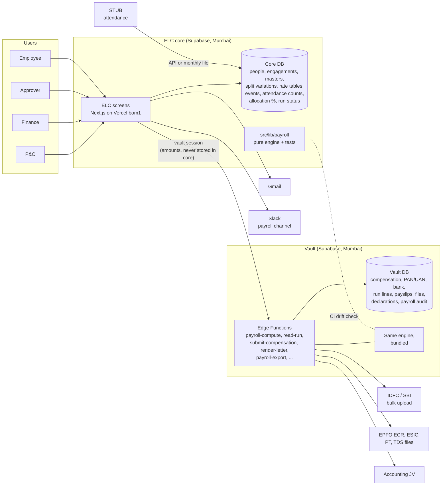
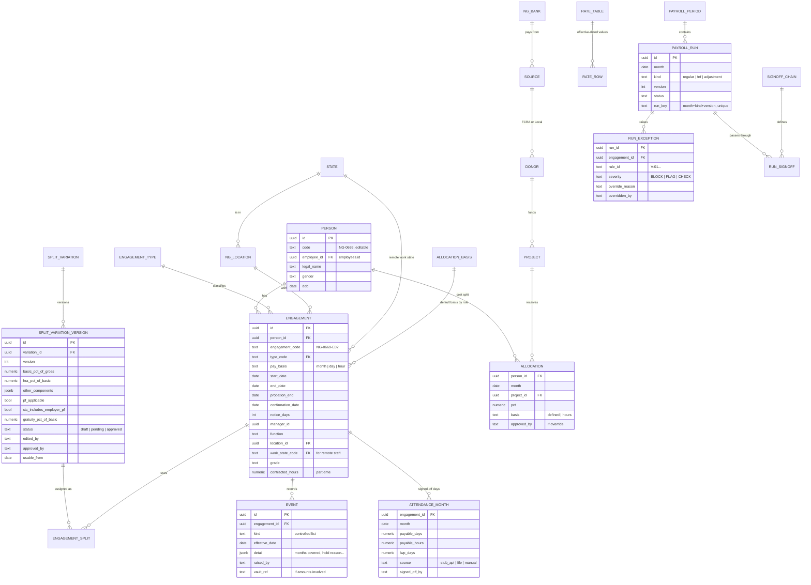
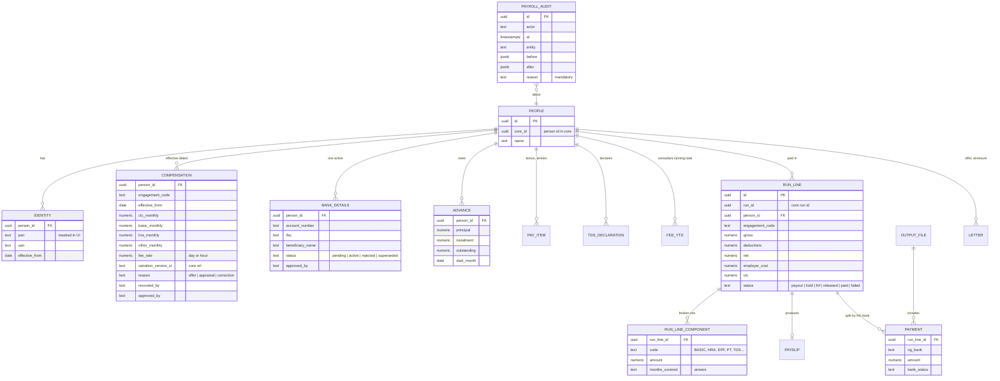
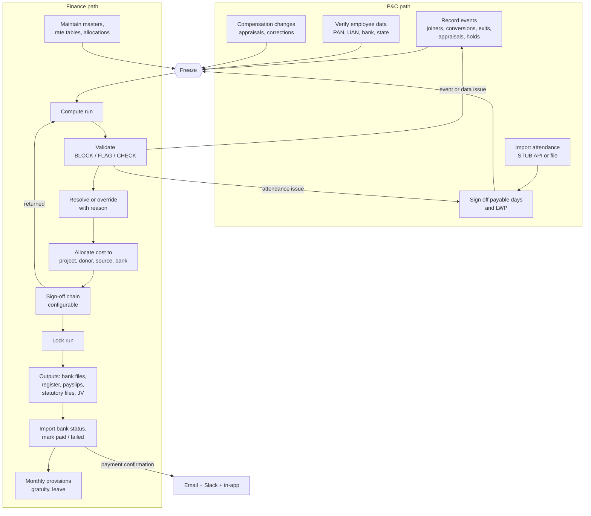
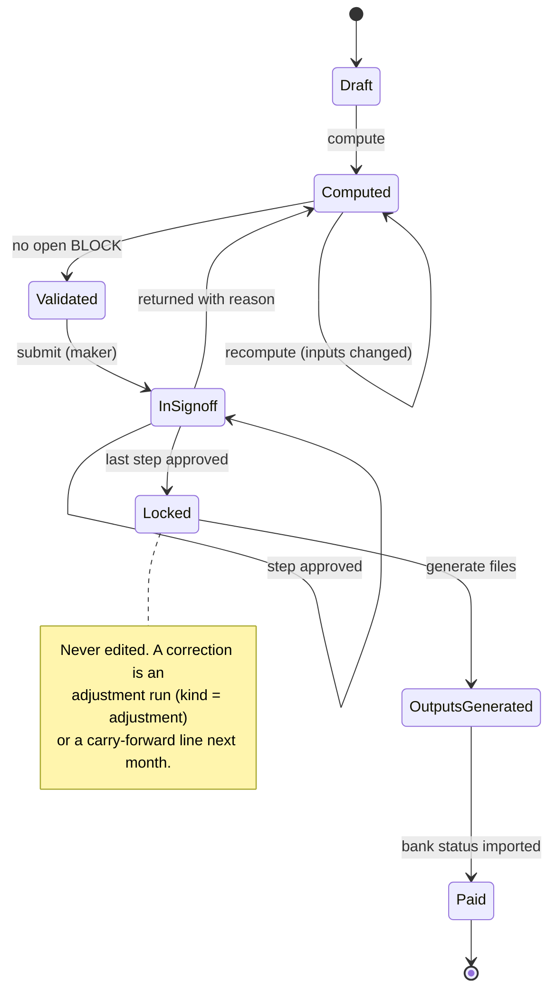
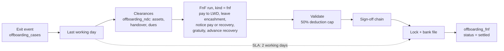

# Payroll — design

Deliverable 1 of Finance's scope: architecture, data model, process flow,
access and audit, and integrations. Read [`README.md`](./README.md) first for
the rule that shapes all of it: **core holds the rules, the vault holds the
values.**

## 1. Architecture

Key properties:

- **One engine, two homes.** `src/lib/payroll/` is pure TypeScript with no
  I/O, tested in ELC CI on the synthetic sample. The same module is bundled
  into the `payroll-compute` vault Edge Function, pinned to `ap-south-1`. A CI
  step fails if the bundled copy differs from the source.
- **Core sends rules and ids; the vault returns figures to the browser.** A
  compute call carries the run id; the vault reads rules and inputs from core
  through a read-only, narrow endpoint, reads amounts from its own tables,
  writes run lines, and returns totals and exceptions. Core records only the
  run's status and exception codes.
- **Screens read amounts with the viewer's own vault session**, the existing
  `vault_session` route in [`../rbac.md`](../rbac.md). Every read is written to
  the vault's append-only `access_log`.
- **Write-only paths for Ops roles.** PnC Ops and Fin Ops are not vault users
  for amounts they may not read; they submit through core-signed, insert-only
  vault functions (the `submit-documents` pattern).

## 2. Data model

All tables that carry business facts are **effective-dated and never
overwritten**: a change closes the current row (`effective_to`) and opens a new
one. Masters carry `effective_from` / `effective_to` too.

### 2.1 Core

New compared with today: `person` (a thin layer over `employees` so that a
candidate, an intern and a converted employee are one person), `engagement`,
`indian_states` and `ng_locations.state_code` (built), split variations (replacing the single
`salary_rules` default), events, attendance months, project / donor / source /
NG bank masters, allocation basis and allocations, rate tables, and the run's
workflow tables.

### 2.2 Vault

`people`, `compensation` and `bank_details` already exist in
`supabase/vault/migrations/0001_vault_schema.sql`; this design extends
`compensation` (fee rate, engagement code, variation reference, approver) and
adds the rest.

### 2.3 Why a person and an engagement

The sample has 32 person-months with two full rows: the month an intern
converts to an employee. Finance's model closes one engagement and opens the next on the
same person code. ELC today overwrites `employees.employee_type` on
conversion, losing the old engagement. `person` keeps one identity across
candidate → intern → employee; `engagement` keeps each contract, with its own
pay basis, split and dates.

## 3. Monthly process — two connected paths

Dates are set per month in payroll settings (D-15). "Freeze" below is that
month's configured freeze date, not a fixed day.

Hand-offs between the two paths:

| Hand-off | From → to | Carries |
|---|---|---|
| Events ready | P&C → Finance | All events up to freeze, each with an effective date |
| Days signed off | P&C → Finance | Payable days / hours and LWP per engagement |
| Data verified | P&C → Finance | PAN, UAN, bank, state checked for new and changed people |
| Exception returned | Finance → P&C | A validation that only P&C can resolve (missing event, attendance dispute) |
| Run locked | Finance → P&C | Final status per person, holds with reasons |
| Exit | P&C → Finance | Last working day, clearances (`offboarding_ndc`) → FnF run |

Reminders: the freeze date sends P&C and line managers a reminder for missing
attendance at T−48h and T−24h, by email, the payroll Slack channel, and an
in-app task.

## 4. Run states

- **Idempotent.** `run_key = month + kind + version` is unique. Recomputing a
  run that is not locked replaces its lines; computing a locked run is refused.
- **Re-runnable for any past month.** The engine takes `asOf` and reads rate
  tables, variations and events as they stood, so a past month recomputes to
  the same figures.
- **Segregation of duties.** No person signs two steps of the same run, and the
  maker cannot sign any step. Enforced in the vault function, not only in the
  UI.

## 5. FnF

A dashboard lists unsettled FnFs with ageing against the 2-working-day SLA.
P&C own the offboarding case and clearances; Finance own the FnF computation
and payment. `offboarding_fnf` holds the status in core; the amounts are in
the vault.

## 6. Events: Finance's list mapped to ELC

| Event | Source in ELC | Notes |
|---|---|---|
| Joiner | Onboarding provisioning (candidate → employee) | Creates the person and the first engagement |
| Conversion | `employees.conversion_date` → close engagement, open next | Two run lines in the conversion month |
| Appraisal | New vault `compensation` row, `reason = appraisal` | Approved after freeze → paid next month with arrears |
| Arrears | Payroll event with months covered | More than one month needs Finance sign-off |
| LWP | Attendance import (STUB), signed off by P&C | |
| Exit initiated | `offboarding_cases` created | |
| Last working day | `offboarding_cases` LWD | Triggers FnF |
| No work / No invoice | Payroll event | Consultants; invoices later (D-20) |
| Bank change | Vault `bank_details` new pending row → approval | |
| Advance | Vault `advance` | Recovery schedule |
| Hold / Release | Payroll event with reason, release date, approver | Replaces free-text "Hold - …" |
| Bonus / incentive | Vault `pay_item` with reason | |

Payment status is a controlled list: Payout, Hold, Released, Paid, Failed, FnF.

## 7. Access

Built on the roles in `src/lib/rbac/roles.ts`. Changes needed:

| Role | Payroll access | Change from today |
|---|---|---|
| Fin Ops | Maker: compute, resolve exceptions, generate files; enter CTC write-only | Widen from "View (payroll export)" |
| Fin Admin | Checker; edits split variations; enters and edits CTC | — |
| PnC Admin | Approves split-variation edits; enters and edits CTC; P&C path | — |
| PnC Ops | P&C path: events, attendance sign-off, data verification; CTC write-only | New write-only salary path |
| Approver | Final step(s) of the configurable chain | New role or qualifier (O-02) |
| Exec View, managers, others | Totals views, only where Super Admin has switched them on | New toggle (D-23) |
| Employee | Own payslips, structure, Form 16, raise a query | Via the letter route |
| Platform Admin / Ops | Masters and rate tables are config; **no amounts, no vault** | — |

Every role change goes through `roles.ts`, `npm run rbac:matrix`, and a
reviewed diff of [`../rbac.md`](../rbac.md).

## 8. Audit

- **Payroll changes** (compensation, bank, advances, pay items, overrides,
  sign-offs) are logged in the vault's `payroll_audit`: actor, time, entity,
  before, after, and a **mandatory reason**. Append-only, like `access_log`.
- **Reads** of amounts are logged in the vault's `access_log`.
- **Core-side events** with no amounts (a master changed, a run moved state,
  an attendance sign-off) go to `employee_audit_log` under a new `payroll`
  module.
- The ELC audit screen shows one merged timeline. Vault entries appear only to
  viewers with a vault session and access to that resource (D-04).

## 9. Integrations

| Integration | Direction | Status in ELC | Notes |
|---|---|---|---|
| STUB attendance | In | Mock interface in `src/lib/integrations/attendance.ts` | API adapter and file import, same staging table (D-14) |
| Gmail | Out | `src/lib/email/sendEmail.ts` | Reminders, payslip notices, payment confirmations |
| Slack | Out | Token exists, no adapter | Payroll channel; never amounts in messages |
| Cron | — | `src/app/api/cron/*`, `vercel.json` | Freeze reminders, FnF ageing |
| Bank bulk upload | Out | None | IDFC and SBI formats (F-08); one file per NG bank; FCRA only from FCRA account |
| Bank status | In | None | Mark paid / failed |
| PF ECR | Out | None | EPFO ECR text format (S-03) |
| ESIC, PT, TDS working files | Out | None | Upload files only; filing on portals stays manual |
| Form 16 data | Out | None | Yearly, per employee, as a document |
| Accounting JV | Out | None | Format depends on F-10 |
| Export | Out | None | CSV / XLSX; Sheets subject to O-05 |

## 10. Non-functional

- Re-runnable for any past month; idempotent run key.
- Mid-month rate changes handled by day-proration (the PF ceiling change on
  17-Sep-2026 is the test).
- Google Workspace SSO (ELC already signs in with Google).
- No amounts in core, in Slack, in email bodies, or in logs.
- Exports to CSV / XLSX.
- Everything stored in `ap-south-1`.

---

## Appendix A — the 54 `Personnel` columns

Tags: **input** (typed by P&C or Finance today), **master** (from a master
table), **event** (from the event list), **computed** (the engine), **check**
(a validation, not stored).

| Col | Sheet column | Tag | In ELC |
|---|---|---|---|
| A | Emp ID | master | `person.code` |
| B | Name | master | `person.legal_name` |
| C | Email IDs | master | `employees.email` |
| D | DOJ | master | `engagement.start_date` |
| E | Initiative | master | project master |
| F | Function | master | `engagement.function` |
| G | Location | master | `engagement.location_id` → `ng_locations` (removes "Campus G" spelt three ways) |
| H | Program Type (for finance) | master | project master |
| I | Project Code (for finance) | master | `allocation.project_id` |
| J | Ledger Name (for finance) | master | project master |
| K | Consultant / Employee | master | `engagement.type_code` (interns no longer filed as "Consultant") |
| L | Pay by Days/Hours | master | `engagement.pay_basis` |
| M | BASIC SALARY | input → vault | `compensation.basic_monthly` |
| N | HRA | input → vault | `compensation.hra_monthly` |
| O | OTHER ALLOWANCE | input → vault | `compensation.other_monthly` |
| P | Gross Pay As Per CTC | computed | `M+N+O`; consultants: fee rate |
| Q | Payble Days As Per Attendance | input | `attendance_month.payable_days` |
| R | Wk Off | input | attendance import |
| S | Holiday | input | attendance import |
| T | Max Work Days | input | attendance import |
| U | LWP | event | `attendance_month.lwp_days` |
| V | Total Payable Days / Hours | computed | `Q − U`; hourly: hours (typed today, imported in ELC) |
| W | BASIC Payable | computed | `ROUND(M × V / days_in_month)` |
| X | HRA Payable | computed | `ROUND(N × V / days_in_month)` |
| Y | OTHER ALLOWANCE Payable | computed | `ROUND(O × V / days_in_month)` |
| Z | Gross Pay As Per Attendance | computed | `W+X+Y`; consultant days `ROUND(P × V / days)`; hours `ROUND(P × V)` |
| AA | Arrears | event → vault | arrears pay items with months covered |
| AB | Gross Pay (Total) | computed | `Z + AA` |
| AC | EPF ACTUAL DED | computed | rate table PF; compared with paid |
| AD | EE-ESIC | computed | rate table ESIC |
| AE | Professional Tax | computed | PT slabs by state, gender, month |
| AF | ADVANCE | event → vault | advance recovery schedule |
| AG | TDS | computed | salary: projection; consultant: YTD rule |
| AH | Total Deductions | computed | `AC+AD+AE+AF+AG` |
| AI | Net Pay | computed | `AB − AH` |
| AJ | Source | master | project → donor → source |
| AK | Name of the Employee | check | bank beneficiary name match (V-02) |
| AL | Bank Account | vault | `bank_details.account_number` (no bank columns in computation) |
| AM | IFSC Code | vault | `bank_details.ifsc` |
| AN | Er Share - PF | computed | employer PF 13% |
| AO | Er Share - ESIC | computed | employer ESIC |
| AP | CTC | computed | `AB + AN + AO` |
| AQ | Payment Status | event | controlled list (replaces three free-text "Hold - …" variants) |
| AR | Remarks From PnC | event | controlled events; free text only as a note on an event |
| AS | Previous Month CTC | check | variance vs previous run line |
| AT | CTC Variance | check | must map to an event (V-20) |
| AU | Previous Month Net | check | |
| AV | Net Variance | check | must map to an event (V-20) |
| AW | Current Work Location | master | state, from location or remote work state |
| AX | Gender | master | `person.gender` (PT slabs) |
| AY | UAN | vault | `identity.uan` |
| AZ | Month | — | `payroll_run.month` |
| BA | Donor | master | project → donor |
| BB | NG Bank | master | source → NG bank |

Sheet anomalies the engine removes:

- Hours rows have payable hours typed in column V instead of a formula
  (60 rows).
- "Campus G" appears as `Campus G`, `Campus G ` and `Campus-G`.
- One basic salary is non-integer (`TS-0045`, 22,984.17).
- Interns are filed under "Consultant".
- Six `±CTC` split rows stand in for an allocation table (`TS-0107`,
  `TS-0278`, `TS-0282` in Jul-26).
- Events are free text in Remarks ("New Joiner", "New Joinee", "new joiner"
  are one event).
